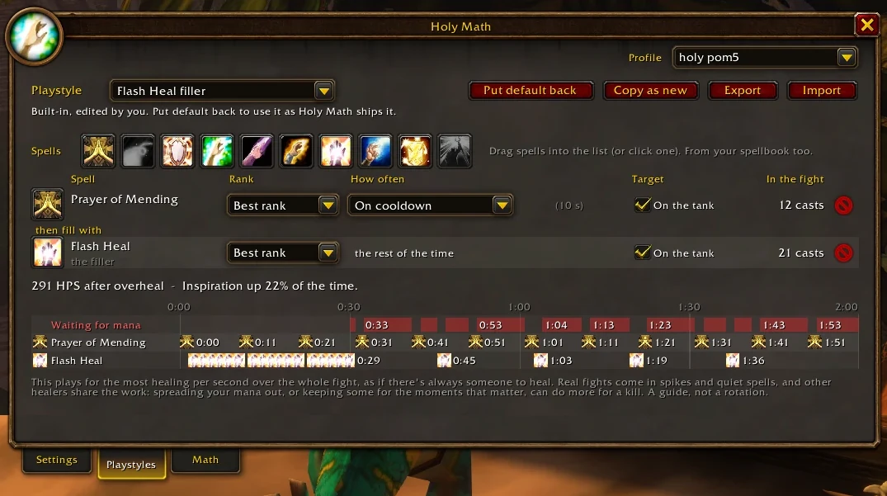
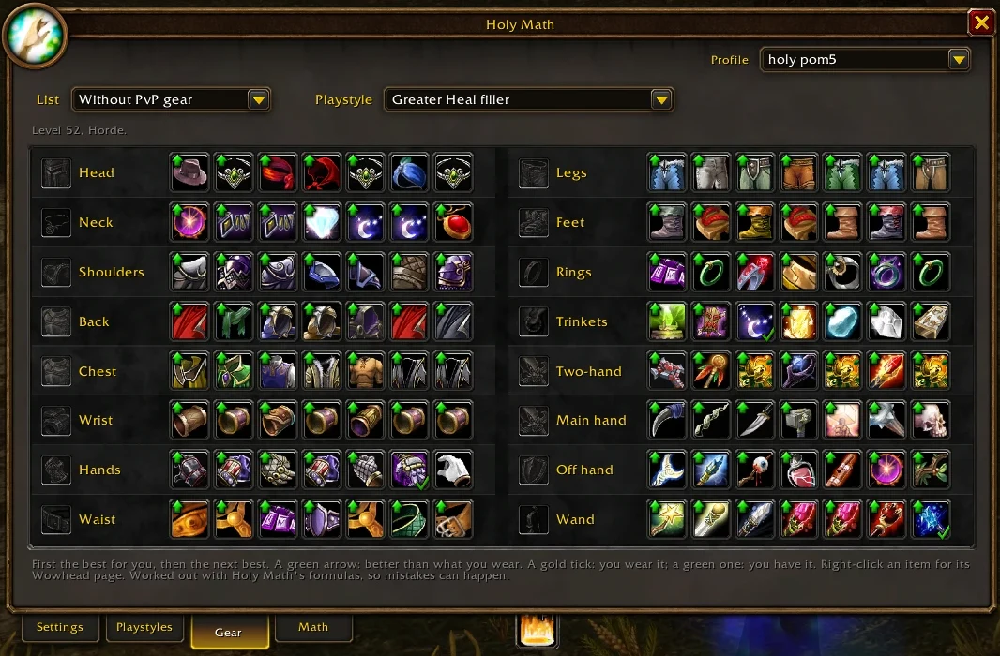
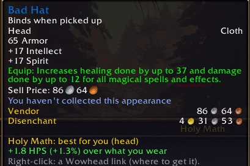

# Holy Math

The maths behind a healing priest in **World of Warcraft: Forever**, worked out on your own live stats and the game's own spell data. Get it on [CurseForge](https://www.curseforge.com/wow/addons/holy-math/).


## What it does

- **Item tooltips:** how much an item gains or loses you in healing per second, e.g. `Holy Math: +16.2 HPS (+1.8%)`. The whole model is rerun with the item swapped in, not a fixed stat weight. Gear a priest can't use says so ("can't wear Plate", "for Mage only").
- **Spell tooltips:** on the tooltip of every healing spell rank you know, what that rank heals per mana and per second after overheal, and which of your ranks is the most efficient, e.g. `Holy Math: 5.26 healing per mana, 1,089 per second` / `Most efficient: Rank 7 (6.15 per mana)`. Worked out with the real downranking penalty, which the game's own tooltip doesn't always show.
- **Your HPS and stat values:** what you heal per second over a fight, and what each stat is worth to you in healing power right now: intellect, MP5 and spirit per point, crit and haste per 1% (the way gear gives them).
- **Gear:** the mathematically best gear for you at your level (at 60, your best in slot), from what's out now in WoW: Forever, for your faction, worked out with your playstyle, talents and settings, trinket effects included, with and without PvP gear. Switch playstyle right on the tab to see its list. Green arrows mark the upgrades over what you wear, and each slot shows the next best.
- **Playstyles:** Renew filler, Greater Heal filler, Flash Heal filler, Prayer of Healing filler, PW:Shield on tank, and Renewed Hope tank (Discipline, with the talent). Each picks the spell ranks that heal the most for you. Change them, or build your own from spell blocks on the **Playstyles** tab, and share them as a line of text.
- **Math tab:** a sheet of how every number is worked out, with your own numbers in it. It starts with **Your spells**: every healing spell you know with its heal, mana, healing per mana and per second, its most efficient rank (the one that heals the most per point of mana) and the overheal you expect from it, set once for all its ranks. Click a spell to unfold all its ranks, with how much of your healing power each low rank still gets. Below that: your stats and talents, the fight (its mana, and how many times each spell is cast), then one cast of each of those spells worked out step by step, each stat value, and the fight's other assumptions. Every line says where its number comes from: the game, the game data, measured in game, your setting, or an assumption of the model.

  

- **Type your own numbers:** click any boxed value on the Math tab (healing power, crit, a crit's size, regen, a talent's value, overheal, ...) and type over it. A spell rank's own data (base heal, coefficient, cost) is the game's, read from its tooltips, so it isn't typed over. Your value is then used everywhere (HPS, stat values, Your spells, item tooltips) and shows in blue, with an arrow that puts the game's back. A line at the bottom of the window says how many are yours; right-click one, or **Put all back**, or `/hm reset`, to use the game's again.
- **Keeps up with patches by itself:** every spell rank you know takes its cost, cast time and heal from the game itself (its own spell tooltip, which already has your healing power and talents in it), so a patch that changes a spell's heal, cost or cast time is picked up without an update and without you doing anything. `/hm check` shows what was read and where it differs from the game data.

Everything recalculates by itself when your gear, buffs, talents or settings change.

## Install

Download from [CurseForge](https://www.curseforge.com/wow/addons/holy-math/) (or with the CurseForge app), or copy the `HolyMath` folder into `World of Warcraft/_forever_/Interface/AddOns/` yourself, and restart the game. Holy Math stays off on other classes.

## Use

| Command | |
|---|---|
| `/hm` | open or close the window |
| `/hm show` | the summary in chat |
| `/hm check` | where every number comes from, and how the model compares with the game |
| `/hm dump` | save everything Holy Math reads (for bug reports), then `/reload` |
| `/hm set fight <seconds>` | fight length, and other settings (`/hm set` lists them) |
| `/hm profile [name]` | list your profiles with their HPS, or load one (for a macro) |
| `/hm playstyle [name]` | list the playstyles with their HPS, or use one; `/hm playstyle export <name>` / `import <line>` |
| `/hm minimap` | hide or show the minimap button |
| `/hm reset` | put back every value you typed on the Math tab |

The **minimap button** opens the window (click) or its Gear tab (right-click); drag it to move it around the minimap. "Show the minimap button" on the Settings tab hides it.

The **Settings** tab holds the fight: its length (default 120 s, a typical raid boss), playstyle, Prayer of Mending bounces, how many people your group heals reach (Prayer of Healing and Holy Nova: 5, a full party, unless you set fewer), Mana Tide, Inspiration and your potions, next to the result, and what the tooltips show (the item line at all, its number, its %, and the spell line). Your spells and the overheal you expect per spell are at the top of the **Math** tab (Settings has a button to it), and the bottom of the Settings tab shows which version you have. Every setting explains itself on hover.

**Potions** (Settings tab): add the potions and runes you drink in a fight and how many of each. Mana potions (Major Mana, Restored Mana, Major Rejuvenation, Tessa's Tonic, ...), Forever's new Mender's Potions (extra healing for 30 s) and Dreamless Sleep all share the potion cooldown, so together they fit only so many times in the fight (3 in 5 minutes); runes (Demonic and Dark Rune) have their own cooldown and come on top. Counts stop at what fits, and "as many as fit" follows the fight length. The list shows what each potion is worth to you, and the best mix of yours for the fight (e.g. Mender's in a short fight with mana to spare, mana potions in a long one), with **Use it** to take it. A Mender's Potion counts as healing power on average over the fight: heals grow in a straight line with healing power, so the average heals exactly as much as the potion does while it lasts.

**Playstyles** (Playstyles tab): the playstyle you use, as a stack of spell blocks, top first; the last block fills the time and mana that are left. Drag a spell from the row of icons into the stack (or click it), or drag one from your spellbook, which brings its rank. Drag a block to move it, or off the stack to remove it; right-click it for the same moves. The order is the priority. Each block has a rank (the best one for you, your highest, or one you pick), how often (on cooldown, keep it up, at most so many times a minute, at most every so many seconds) and whether it's cast on the tank: only crits on the tank count for Inspiration, and with "Keep Weakened Soul on the tank" only heals on the tank get Renewed Hope's extra crit. Each block shows how often it's cast in the fight (hover it for what stopped it), and the HPS updates as you build.



Under the blocks, **the fight** is drawn the way Lorrgs draws one: a row for when you wait for mana, then a row per block with an icon and time for each cast (icons overlap where you cast back to back) and a bar for what lasts, such as Renew's 15 s. The casts are the ones the model counts, placed by priority: an example of the fight, not the only way to play it; hover a row for its casts. A note under it says what it is: the most healing per second over the whole fight, as if there's always someone to heal. Real fights come in spikes and quiet spells and other healers share the work, so spreading your mana out or keeping some for the moments that matter can do more for a kill; it's a guide, not a rotation.

Change a built-in and it's saved as your edit of it (**Put default back** undoes that); **Copy as new** makes one of your own. **Export** gives a line like `HM1:Renew + Inspiration;POM,b,cd,t;LESSER,2,20pm,t;GH,b,2pm,t;RENEW,b,fill` to share, and **Import** reads one back (it's only read as text, never run).

**Gear** (Gear tab): the best gear for you at your level; at level 60, your best in slot. It's what is mathematically best, the items that give you the most healing per second through Holy Math's fight model, not a list copied from a guide: it changes with your talents, playstyle and settings. Holy Math takes your character as it is (level, talents, race, buffs, fight length and every other setting), takes off what you wear, and tries the items you could wear instead through the whole fight model, set bonuses included. The **Playstyle** dropdown at the top is the same setting as on the Settings tab: change it and the list is worked out again for that playstyle at once. It's laid out like KeystoneLoot's loot window, with a row per slot instead of per dungeon: the best item first (two for rings and trinkets), then the next best. The weapons are shown both ways: the best two-hander, and the best main hand with the best off hand; hovering one says what each way heals.

A green arrow marks each item that is better for you than what you wear in that slot (on its own, worked out through the whole model); a gold tick marks what you wear, a green one what you have in your bags or bank. Hover an item for the game's tooltip, what it (with its random suffix, such as "of Healing") is worth over what you wear, its set bonuses and its use or proc effect; shift-click links it, and right-click gives its Wowhead page (where to get it) to copy. Only what's out now in WoW: Forever and what your faction can get; "With PvP gear" adds honor rewards where they're better. Items only one profession can use (Truefaith Vestments) count only if you have that profession.

It's worked out in well under a second, a few milliseconds a frame while the tab is open (none in combat), and again when something it depends on changes: what you wear, your level, the playstyle or any other setting at once, a buff coming or going at most every 10 seconds. Use and proc effects count too, averaged over your fight, here and in the item tooltips: a use as often as it fits, ready at the start of each fight (one with a cooldown longer than the fight in the share of fights it's ready, by **Time between pulls** on the Math tab: 10 minutes unless you set it, about 1 to 2 for dungeons), mana as MP5, a heal on yourself after your Flash Heal overheal, a proc on your heals by its chance and your casts (Dormant Heart of the Mountain by your Greater Heals), and a catch along with it (Mindtap Talisman's −60 intellect for 2 minutes). Drinks and channels don't count, nor effects that do nothing for healing (absorbs, damage, speed), nor procs on harmful spells. Enchants aren't counted.



Hover an item on the Gear tab for what it's worth to you over what you wear:



**Profiles** (top right of the window): keep several sets of settings under any name, e.g. "1 bounce", "3 bounces", "5 min, no Mana Tide", and switch between them. A profile holds the fight, the playstyle and the overheal per spell; values you typed over the game's on the Math tab are not part of it. The loaded profile saves itself: whatever you change goes into it, and "New profile" starts one from your settings now. The list shows what each profile heals per second with your gear right now, so you can compare them without switching, and hovering one shows how it differs from your current settings.

## Where the numbers come from

- **Your stats** (healing power, crit, mana, regen, talents, known ranks) are read from the game.
- **Your spells** (each known rank's cost, cast time and base heal) are read from the game too, with your talents, haste and healing power taken back out so the model can apply them again. A number that changes only for a moment (a buff that cuts costs) doesn't replace the one read before; one that stays changed for 2 minutes does. One that can't be right (under half or over double the game data) is left out. Inside dungeons and raids the heals aren't read at all (the tooltips there can show low ranks healing much more than they do); the ones read outside are kept. Text the game hasn't loaded yet is asked for, and read as soon as it arrives. Coefficients, the downranking rule and ranks you haven't learned yet come from the game data below.
- **Spell and talent data** (the starting point for the above, plus coefficients, talent values and spirit regen) is the game's own data as extracted by [wowsims/forever](https://github.com/wowsims/forever). `Models/PriestData.lua` is generated from it by `tools/gen_priest_data.py`.
- **Gear** (`Models/GearData.lua`) is wowsims' item data from the Forever client: stats, slots, required level, sets, and which items are out now (phase 1); its sources only decide which faction can get an item and what's PvP (where to get it is the item's Wowhead page). `tools/gen_gear_data.py` keeps what a priest can wear with a healing stat, at any level, less what another item beats in every stat at the same or a lower level; `Models/GearSolve.lua` picks from it in game. An item that states no required level (most quest rewards), or level 1 for higher content, counts from its item level less 5, the rule nearly every item follows. Set bonuses are wowsims' set rows. A mana proc counts as MP5 at the fight's cast rate. PvP rewards carry no faction in the data, so their rank or set name decides it. An equip limit (one Warden's Signet at a time) is kept.
- **Cooldowns and durations** behind "on cooldown" and "keep it up" (Prayer of Mending 10 s, Penance 12 s, PW:Shield 4 s and Weakened Soul 15 s, Renew 15 s) are the game data too.
- **Discipline shields**, from the same game data: Soul Warding takes the shield's 4 s cooldown away and 15% off its cost. A shield on the tank waits for Weakened Soul, and each Flash Heal, Lesser Heal, Heal, Greater Heal or Penance on the tank takes 1 to 5 s off it with Renewed Hope (by rank). Their extra crit counts only on the tank, only for the share of the fight Weakened Soul is up. Divine Aegis leaves a share of each crit's own amount, at most 20 × your level per heal. A crit's absorb stacking up on someone who takes no damage isn't modelled.
- **Potions and runes**: their numbers are Wowhead's Forever item data (Nov 2026); the Mender's Potions' 2 minute cooldown is from the game's own tooltip. That they share it with mana potions is checked in game.
- **The fight model** (mana budget, cooldowns, regen pauses, Inner Focus, Inspiration) started as a port of [doublezug's healer-priest spreadsheet](https://docs.google.com/spreadsheets/d/19SaCaDQJzhMFL-nIW4ryzFwI53FmsnDvaxRfLbvM-CE/edit?gid=1807392634#gid=1807392634). Its formulas are reproduced exactly in the tests, and the places where the game shows something different are corrected and documented in the code.
- **Checked in game:** costs (with talents such as Improved Healing), base heals, coefficients, downranking (the penalty starts 12 levels after a rank's max level, and a rank never drops under 10% of its coefficient; doublezug's level-60 measurements of Renew and Flash Heal fit this within 1%), Holy and Discipline talent values (Litany of Light: 5% of the base cost back at 1/2, 10% at 2/2), intellect to crit (the game data's level-60 value, and measured at 49 and 50), and the regen formula all match the client's own numbers. Prayer of Mending ignores the healing power Spiritual Guidance gives you from spirit, as the client's tooltip shows.
- **Downranking and tooltips:** the game's spell tooltips don't always show the downranking penalty. A level-50 Holy priest's showed low ranks at full healing power while their real heals still had the penalty (Renew rank 1 ticks for exactly the penalised amount); a level-50 Shadow priest's showed the penalty. Inside dungeons, low ranks' tooltips have been seen healing far more than they do, until you leave. Holy Math works out which your client does each time it reads them, doesn't read them inside instances, and always uses what the spells really heal.

## Development

The model runs outside the game too:

```bash
lua5.1 tests/run_tests.lua    # the model: the sheet reproduced, and the client's own tooltip numbers
lua5.1 tests/smoke_wow.lua    # the whole addon against a fake game client
```

Players don't need an update when a patch changes spell numbers. To refresh the built-in starting point (and the coefficients) after a patch, regenerate the spell data from a fresh wowsims checkout:

```bash
git clone --depth 1 https://github.com/wowsims/forever /tmp/wowsims-forever
python3 -I tools/gen_priest_data.py /tmp/wowsims-forever > Models/PriestData.lua
```

The Gear tab's items come from the same checkout:

```bash
python3 -I tools/gen_gear_data.py /tmp/wowsims-forever > Models/GearData.lua
```

## Credits

- Spell and item data: [wowsims](https://github.com/wowsims/forever), MIT licence (notices in `Models/PriestData.lua` and `Models/GearData.lua`).
- The Gear tab's layout takes its idea from [KeystoneLoot](https://www.curseforge.com/wow/addons/keystoneloot)'s loot window.
- The original healing model: [the healer-priest spreadsheet for WoW: Forever](https://docs.google.com/spreadsheets/d/19SaCaDQJzhMFL-nIW4ryzFwI53FmsnDvaxRfLbvM-CE/edit?gid=1807392634#gid=1807392634) by **doublezug**. Its formulas, playstyles and in-game measurements (downranking, coefficients) are what Holy Math was built from.

## Licence

Holy Math is free software under the [GNU General Public License v3.0](LICENSE). The spell and item data in `Models/PriestData.lua` and `Models/GearData.lua` comes from wowsims under the MIT licence; its notice is kept in those files.
