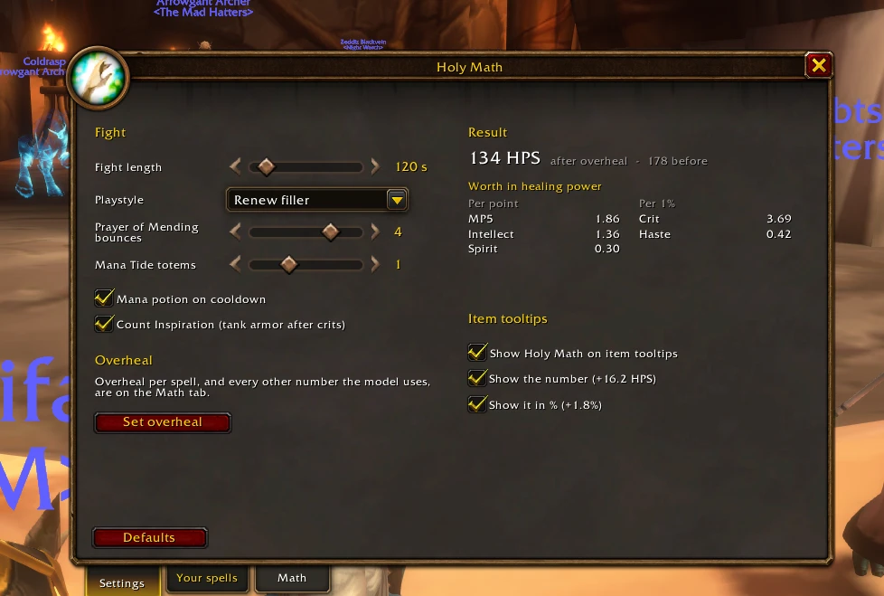
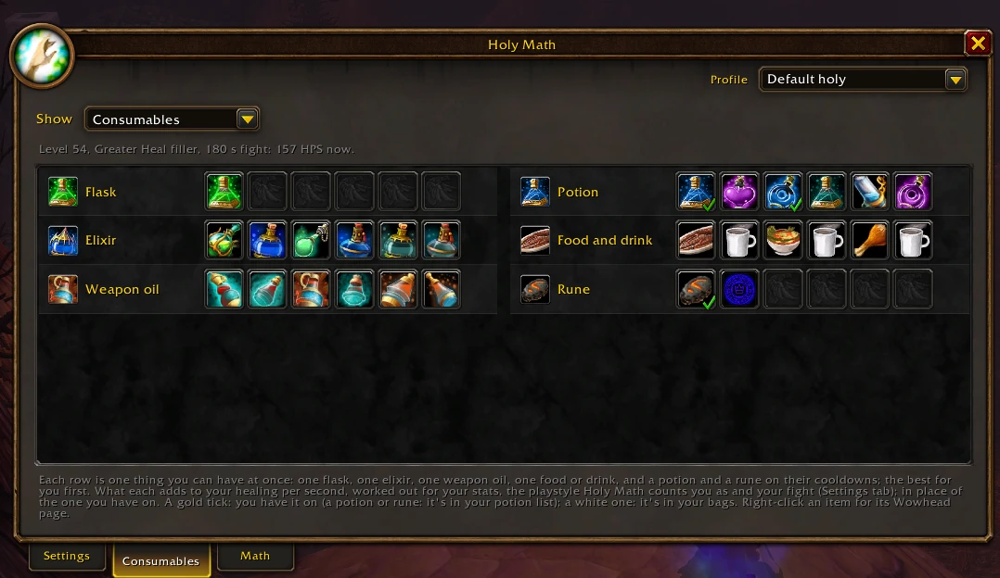

# Holy Math

The maths behind a healing priest in **World of Warcraft: Forever**, worked out on your own stats and the game's own spell data. Get it on [CurseForge](https://www.curseforge.com/wow/addons/holy-math/).



## What it does

- **Item tooltips:** how much an item would raise or lower your healing per second, e.g. `Over what you wear  +16.2 HPS (+1.8%)`. For rings and trinkets you get a line for each of the two you wear.
- **Spell tooltips:** heal per mana and per second for every rank you know, and which rank is the most efficient.
- **Your HPS and stat values:** what you heal per second in a fight, and what intellect, MP5, spirit, crit and haste are worth to you right now.
- **Consumables and enchants:** the best flask, elixir, weapon oil, food or drink, potion and rune for you, and the best enchant for each slot, ranked by what each adds to your healing.
- **Math tab:** every number worked out step by step, with your own stats in it. Click a value to type your own.

Everything updates by itself when your gear, buffs, talents or settings change. Holy Math counts you with the best way to use the spells you know, or a playstyle you pick on the Settings tab.




## Install

Download it from [CurseForge](https://www.curseforge.com/wow/addons/holy-math/), or copy the `HolyMath` folder into `World of Warcraft/_forever_/Interface/AddOns/` and restart the game. It only turns on for priests.

## Use

Click the minimap button (or type `/hm`) to open the window. Right-click the button for the Consumables tab.

| Command | |
|---|---|
| `/hm` | open or close the window |
| `/hm show` | a summary in chat |
| `/hm check` | where every number comes from |
| `/hm dump` | save what Holy Math reads, for bug reports (then `/reload`) |
| `/hm set fight <seconds>` | the fight length; `/hm set` lists the other settings |
| `/hm profile [name]` | list your profiles, or load one |
| `/hm minimap` | hide or show the minimap button |
| `/hm reset` | undo every value you typed on the Math tab |

**Settings tab:** the playstyle Holy Math counts you as, your HPS, what each stat is worth, and your fight: its length, Prayer of Mending bounces, group size, Mana Tide and the potions you drink.

**Consumables tab:** one row for each thing you can have at once, best first. Your active buffs are already in your stats, so each item is counted in place of the one you have on. A gold tick marks what you have on (or the potion in your list), a white tick what's in your bags. Switch **Show** to **Enchants** for the best enchant per slot, counted over the enchant on your item. Right-click any icon for its Wowhead link.

**Profiles** (top right): keep several sets of settings, such as a short and a long fight, and switch between them.

## Where the numbers come from

- **Your stats and spells** are read from the game, so a patch that changes a spell is picked up without an update.
- **Spell, item, consumable and enchant data** is the game's own, as extracted by [wowsims/forever](https://github.com/wowsims/forever).
- **The fight model** started as a port of [doublezug's healer-priest spreadsheet](https://docs.google.com/spreadsheets/d/19SaCaDQJzhMFL-nIW4ryzFwI53FmsnDvaxRfLbvM-CE/edit?gid=1807392634#gid=1807392634). Where the game shows something different, the game wins.
- **Checked in game:** spell costs, heals, coefficients, downranking, talents, intellect to crit and spirit regen.

## Development

```bash
lua5.1 tests/run_tests.lua    # the model
lua5.1 tests/smoke_wow.lua    # the whole addon against a fake game client
```

The data files are generated from a wowsims checkout:

```bash
git clone --depth 1 https://github.com/wowsims/forever /tmp/wowsims-forever
python3 -I tools/gen_priest_data.py /tmp/wowsims-forever > Models/PriestData.lua
python3 -I tools/gen_gear_data.py /tmp/wowsims-forever > Models/GearData.lua
python3 -I tools/gen_consumable_data.py /tmp/wowsims-forever > Models/ConsumableData.lua
```

`AGENTS.md` has the details for maintainers.

## Credits

- Game data: [wowsims](https://github.com/wowsims/forever), MIT licence.
- The original healing model: [the healer-priest spreadsheet](https://docs.google.com/spreadsheets/d/19SaCaDQJzhMFL-nIW4ryzFwI53FmsnDvaxRfLbvM-CE/edit?gid=1807392634#gid=1807392634) by **doublezug**.
- The Consumables tab's layout is inspired by [KeystoneLoot](https://www.curseforge.com/wow/addons/keystoneloot).

## Licence

[GNU General Public License v3.0](LICENSE). The data in `Models/PriestData.lua`, `Models/GearData.lua` and `Models/ConsumableData.lua` comes from wowsims under the MIT licence; its notice is kept in those files.
