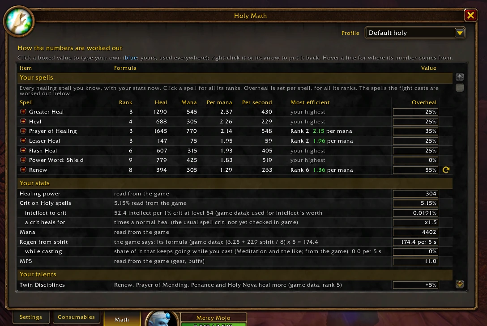

# Holy Math

The maths behind a healing priest in **World of Warcraft: Forever**, worked out on your own live stats and the game's own spell data. Get it on [CurseForge](https://www.curseforge.com/wow/addons/holy-math/).


## What it does

- **Item tooltips:** how much an item gains or loses you in healing per second, e.g. `Holy Math: +16.2 HPS (+1.8%)`. The whole model is rerun with the item swapped in, not a fixed stat weight. Gear a priest can't use says so ("can't wear Plate", "for Mage only").
- **Your HPS and stat values:** what you heal per second over a fight, and what each stat is worth to you in healing power right now: intellect, MP5 and spirit per point, crit and haste per 1% (the way gear gives them).
- **Playstyles:** Renew filler, Greater Heal filler, Flash Heal filler, Prayer of Healing filler, PW:Shield on tank, and Renewed Hope tank (Discipline, with the talent). Each picks the spell ranks that heal the most for you.
- **Math tab:** a sheet of how every number is worked out, with your own numbers in it. It starts with **Your spells**: every healing spell you know with its heal, mana, healing per mana and per second, its most efficient rank (the one that heals the most per point of mana) and the overheal you expect from it, set once for all its ranks. Click a spell to unfold all its ranks, with how much of your healing power each low rank still gets. Below that: your stats and talents, the fight (its mana, and how many times each spell is cast), then one cast of each of those spells worked out step by step, each stat value, and the fight's other assumptions. Every line says where its number comes from: the game, the game data, measured in game, your setting, or an assumption of the model.

  

- **Type your own numbers:** click any boxed value on the Math tab (healing power, crit, a crit's size, regen, a talent's value, overheal, ...) and type over it. A spell rank's own data (base heal, coefficient, cost) is the game's, read from its tooltips, so it isn't typed over. Your value is then used everywhere (HPS, stat values, Your spells, item tooltips) and shows in blue, with an arrow that puts the game's back. A line at the bottom of the window says how many are yours; right-click one, or **Put all back**, or `/hm reset`, to use the game's again.
- **Keeps up with patches by itself:** every spell rank you know takes its cost, cast time and heal from the game itself (its own spell tooltip, which already has your healing power and talents in it), so a patch that changes a spell's heal, cost or cast time is picked up without an update and without you doing anything. `/hm check` shows what was read and where it differs from the game data.

Everything recalculates by itself when your gear, buffs, talents or settings change.

## Install

Download from [CurseForge](https://www.curseforge.com/wow/addons/holy-math/) (or with the CurseForge app), or copy the `HolyMath` folder into `World of Warcraft/_forever_/Interface/AddOns/` yourself, and restart the game. Holy Math stays off on other classes.

## Use

| Command | |
|---|---|
| `/hm` | open or close the window |
| `/hm show` | the summary in chat |
| `/hm check` | where every number comes from, and how the model compares with the game |
| `/hm dump` | save everything Holy Math reads (for bug reports), then `/reload` |
| `/hm set fight <seconds>` | fight length, and other settings (`/hm set` lists them) |
| `/hm reset` | put back every value you typed on the Math tab |

The **Settings** tab holds the fight: its length (default 120 s, a typical raid boss), playstyle, Prayer of Mending bounces, Mana Tide, mana potions and Inspiration, next to the result, and what item tooltips show (the line at all, the number, the %). Your spells and the overheal you expect per spell are at the top of the **Math** tab (Settings has a button to it), and the bottom of the Settings tab shows which version you have. Every setting explains itself on hover.

## Where the numbers come from

- **Your stats** (healing power, crit, mana, regen, talents, known ranks) are read from the game.
- **Your spells** (each known rank's cost, cast time and base heal) are read from the game too, with your talents, haste and healing power taken back out so the model can apply them again. A number that changes only for a moment (a buff that cuts costs) doesn't replace the one read before; one that stays changed for 2 minutes does. One that can't be right (under half or over double the game data) is left out. Coefficients, the downranking rule and ranks you haven't learned yet come from the game data below.
- **Spell and talent data** (the starting point for the above, plus coefficients, talent values and spirit regen) is the game's own data as extracted by [wowsims/forever](https://github.com/wowsims/forever). `Models/PriestData.lua` is generated from it by `tools/gen_priest_data.py`.
- **The fight model** (mana budget, cooldowns, regen pauses, Inner Focus, Inspiration) started as a port of [doublezug's healer-priest spreadsheet](https://docs.google.com/spreadsheets/d/19SaCaDQJzhMFL-nIW4ryzFwI53FmsnDvaxRfLbvM-CE/edit?gid=1807392634#gid=1807392634). Its formulas are reproduced exactly in the tests, and the places where the game shows something different are corrected and documented in the code.
- **Checked in game:** costs (with talents such as Improved Healing), base heals, coefficients, downranking (the penalty starts 12 levels after a rank's max level), Holy and Discipline talent values (Litany of Light: 5% of the base cost back at 1/2, 10% at 2/2), intellect to crit (the game data's level-60 value, and measured at 49 and 50), and the regen formula all match the client's own numbers. Prayer of Mending ignores the healing power Spiritual Guidance gives you from spirit, as the client's tooltip shows.
- **Downranking and tooltips:** the game's spell tooltips don't always show the downranking penalty. A level-50 Holy priest's showed low ranks at full healing power while their real heals still had the penalty (Renew rank 1 ticks for exactly the penalised amount); a level-50 Shadow priest's showed the penalty. Holy Math works out which your client does each time it reads them, and always uses what the spells really heal.

## Development

The model runs outside the game too:

```bash
lua5.1 tests/run_tests.lua    # the model: the sheet reproduced, and the client's own tooltip numbers
lua5.1 tests/smoke_wow.lua    # the whole addon against a fake game client
```

Players don't need an update when a patch changes spell numbers. To refresh the built-in starting point (and the coefficients) after a patch, regenerate the spell data from a fresh wowsims checkout:

```bash
git clone --depth 1 https://github.com/wowsims/forever /tmp/wowsims-forever
python3 -I tools/gen_priest_data.py /tmp/wowsims-forever > Models/PriestData.lua
```

## Credits

- Spell data: [wowsims](https://github.com/wowsims/forever), MIT licence (notice in `Models/PriestData.lua`).
- The original healing model: [the healer-priest spreadsheet for WoW: Forever](https://docs.google.com/spreadsheets/d/19SaCaDQJzhMFL-nIW4ryzFwI53FmsnDvaxRfLbvM-CE/edit?gid=1807392634#gid=1807392634) by **doublezug**. Its formulas, playstyles and in-game measurements (downranking, coefficients) are what Holy Math was built from.

## Licence

Holy Math is free software under the [GNU General Public License v3.0](LICENSE). The spell data in `Models/PriestData.lua` comes from wowsims under the MIT licence; its notice is kept in that file.
