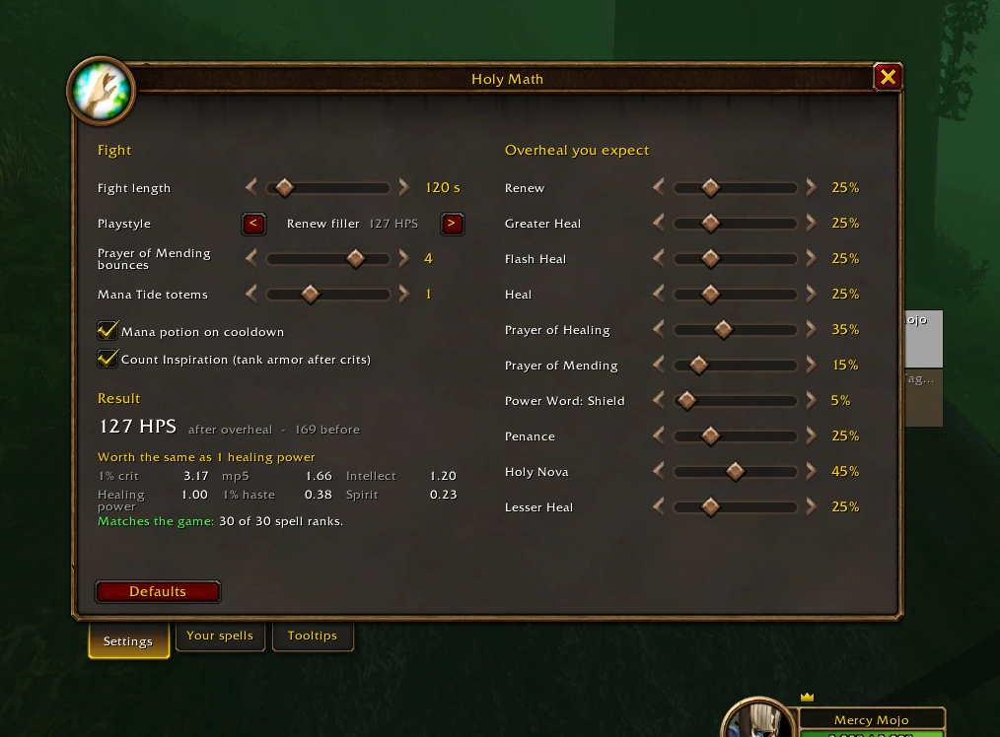

# Holy Math

The maths behind a healing priest in **World of Warcraft: Forever**, worked out on your own live stats and the game's own spell data.



## What it does

- **Item tooltips:** how much an item gains or loses you in healing per second, e.g. `Holy Math: +16.2 HPS (+1.8%)`. The whole model is rerun with the item swapped in, not a fixed stat weight. Gear a priest can't use says so ("can't wear Plate", "for Mage only").
- **Your HPS and stat values:** what you heal per second over a fight, and what intellect, spirit, mp5, crit and haste are worth to you compared with healing power, right now.
- **Playstyles:** Renew filler, Greater Heal filler, Flash Heal filler, Prayer of Healing filler, PW:Shield on tank, and Renewed Hope tank (Discipline, with the talent). Each picks the spell ranks that heal the most for you.
- **Spell overview:** every healing spell you know: heal, mana, healing per mana and per second, and its most mana-efficient rank.
- **Checks itself against the game:** every spell rank you know is compared with the game's own spell tooltip ("Matches the game: 30 of 30 spell ranks").

Everything recalculates by itself when your gear, buffs, talents or settings change.

## Install

Copy the `HolyMath` folder into `World of Warcraft/_forever_/Interface/AddOns/` and restart the game. Holy Math stays off on other classes.

## Use

| Command | |
|---|---|
| `/hm` | open or close the window |
| `/hm show` | the summary in chat |
| `/hm check` | where every number comes from, and how the model compares with the game |
| `/hm dump` | save everything Holy Math reads (for bug reports), then `/reload` |
| `/hm set fight <seconds>` | fight length, and other settings (`/hm set` lists them) |

The **Settings** tab holds the assumptions: fight length (default 120 s, a typical raid boss), playstyle, Prayer of Mending bounces, Mana Tide, mana potions, Inspiration, and the overheal you expect per spell. Every setting explains itself on hover. The **Tooltips** tab controls what item tooltips show.

## Where the numbers come from

- **Your stats** (healing power, crit, mana, regen, talents, known ranks) are read from the game.
- **Spell and talent data** (base heals per rank and level, coefficients, costs, talent values, spirit regen) is the game's own data as extracted by [wowsims/forever](https://github.com/wowsims/forever). `Models/PriestData.lua` is generated from it by `tools/gen_priest_data.py`.
- **The fight model** (mana budget, cooldowns, regen pauses, Inner Focus, Inspiration) started as a port of a community healer-priest spreadsheet. Its formulas are reproduced exactly in the tests, and the places where the game shows something different are corrected and documented in the code.
- **Checked in game:** costs, base heals, coefficients, downranking (the penalty starts 12 levels after a rank's max level), Holy and Discipline talent values, and the regen formula all match the client's own numbers. Prayer of Mending ignores the healing power Spiritual Guidance gives you from spirit, as the client's tooltip shows.

## Development

The model runs outside the game too:

```bash
lua5.1 tests/run_tests.lua    # the model: the sheet reproduced, and the client's own tooltip numbers
lua5.1 tests/smoke_wow.lua    # the whole addon against a fake game client
```

After a game patch, regenerate the spell data from a fresh wowsims checkout:

```bash
git clone --depth 1 https://github.com/wowsims/forever /tmp/wowsims-forever
python3 -I tools/gen_priest_data.py /tmp/wowsims-forever > Models/PriestData.lua
```

## Credits

- Spell data: [wowsims](https://github.com/wowsims/forever), MIT licence (notice in `Models/PriestData.lua`).
- The original healing model: the community healer-priest spreadsheet for WoW: Forever.
